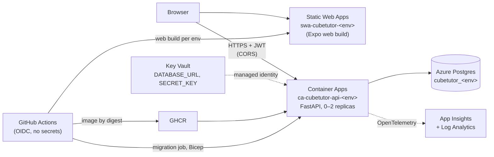

# CubeTutor

An app for learning speedcubing algorithms (OLL, PLL, F2L) on an interactive 3D cube. One codebase runs on the web and on phones: Expo + react-native-web with react-three-fiber on the front end, and FastAPI + Postgres on the back end.

## Live

| Environment | Web app | API | Deployed by |
|---|---|---|---|
| dev | https://ambitious-sea-075b92410.8.azurestaticapps.net | in the latest `Deploy dev` run summary (URL pending: environment recreated in #42) | every merge to `master` |
| prod | not deployed yet (first release) | not deployed yet (first release) | a published `vX.Y.Z` release, after approval |

The API scales to zero, so the first request after a quiet spell takes a few seconds.

## Architecture

Details: [`docs/architecture.md`](docs/architecture.md), [`docs/infra.md`](docs/infra.md), [`docs/ci-cd.md`](docs/ci-cd.md).

## Docs

- **Run it:** see [Running](CLAUDE.md#running) in `CLAUDE.md`.
- **How it's built:** [`docs/architecture.md`](docs/architecture.md), then the other docs in [`docs/`](docs/) and the decision records in [`docs/decisions/`](docs/decisions/).
- **CI/CD and releases:** [`docs/ci-cd.md`](docs/ci-cd.md).
- **Plan:** [`ROADMAP.md`](ROADMAP.md).
