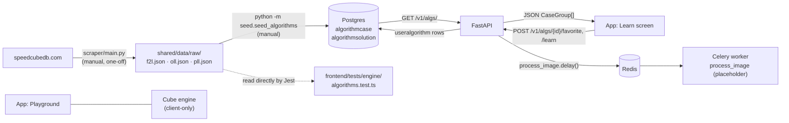

# Architecture

How CubeTutor fits together **as the code stands today**. Planned work lives in [`ROADMAP.md`](../ROADMAP.md), not here.

## Components

| Component | Stack | Code | Runs as |
|---|---|---|---|
| App | Expo SDK 58 (React Native 0.88 + react-native-web), expo-router, Zustand, react-three-fiber, axios | [`frontend/`](../frontend/) | `npm run web` (:8081) or Expo Go |
| API | FastAPI + SQLModel, JWT auth (PyJWT, passlib/bcrypt) | [`backend/app/`](../backend/app/) | `backend` container, uvicorn :8000 |
| Database | Postgres 18 | — | `postgres` container (host :5433) |
| Queue | Redis 8.4 (Celery broker on db 0, result backend on db 1) | [`shared/celery_app.py`](../shared/celery_app.py) | `redis` container (host :6380) |
| Worker | Celery 5.6 | [`worker/main.py`](../worker/main.py), [`shared/tasks.py`](../shared/tasks.py) | `celery` container |
| Scraper | requests + BeautifulSoup | [`scraper/`](../scraper/) | Run by hand, once; not in Compose |
| Admin | pgAdmin 4 | — | `pgadmin` container (:5050) |

Services and ports: [`docker-compose.yml`](../docker-compose.yml), env vars in [`.template.env`](../.template.env).

**`shared/` is bind-mounted** into both Python containers (`./shared → /backend/shared` and `/worker/shared`). That is how the API imports `shared.tasks` and how the seed script finds `shared/data/raw/`. The `backend/shared/` and `worker/shared/` folders in the repo are empty mount points.

## Data flow: scrape → app

1. **Scrape.** [`scraper/main.py`](../scraper/main.py) fetches the F2L, OLL and PLL pages and writes one JSON file per subset into `shared/data/raw/`. See [data-pipeline.md](data-pipeline.md).
2. **Seed.** [`backend/seed/seed_algorithms.py`](../backend/seed/seed_algorithms.py) loads the three files into the `algorithmcase` and `algorithmsolution` tables. It is idempotent.
3. **Serve.** `GET /v1/algs/` returns every case with its solutions, plus the caller's favorite/learned flags. See [backend.md](backend.md).
4. **Show.** The Learn screen ([`frontend/app/(tabs)/learn.tsx`](../frontend/app/%28tabs%29/learn.tsx)) lists them. Toggling favorite/learned posts back optimistically ([`SolutionDetail.tsx`](../frontend/features/learn/components/SolutionDetail.tsx)).
5. **Test.** The engine's Jest tests read the same raw JSON directly and check that every scraped solution solves its setup. See [cube-engine.md](cube-engine.md#how-the-tests-pin-the-conventions).

The **3D cube (Playground)** is entirely client-side. It doesn't call the API. See [cube-engine.md](cube-engine.md) and [rendering.md](rendering.md).

The **Redis/Celery path** is a placeholder. `POST /v1/images/upload` enqueues a fake task. See [data-pipeline.md](data-pipeline.md#celery-tasks).

## Frontend structure

| Path | What |
|---|---|
| [`app/_layout.tsx`](../frontend/app/_layout.tsx) | Root layout: runs `checkToken()` on start and redirects between `(auth)` and `(tabs)` based on the token |
| [`app/index.tsx`](../frontend/app/index.tsx) | Redirects to `/(auth)/login`. Signed-in users are then sent on to `/(tabs)/playground` by the root layout |
| `app/(auth)/` | Login and register screens |
| `app/(tabs)/` | `learn.tsx` (algorithm list) and `playground.tsx` (the 3D cube) |
| [`features/auth/`](../frontend/features/auth/) | Zustand auth store, token storage (SecureStore on native, localStorage on web), API calls |
| [`features/learn/`](../frontend/features/learn/) | Algorithm list components and API calls |
| [`features/cube/`](../frontend/features/cube/) | Engine, parser, store, input, rendering |
| [`shared/api/client.ts`](../frontend/shared/api/client.ts) | axios instance: base URL from `EXPO_PUBLIC_API_URL`, attaches the bearer token, signs out on 401 |

- **No tab bar:** `app/(tabs)/` has no `_layout.tsx`. After sign-in the root layout routes to `/(tabs)/playground`.
- **Open question:** how is a user meant to reach the Learn screen today? I found no in-app link or navigator; on web it is reachable by URL.

## Cross-cutting facts

- **Auth tokens:** the backend issues access + refresh tokens, but the app keeps only the access token. The app signs out on any 401 instead of refreshing. See [backend.md](backend.md#auth-flow).
- **CORS:** allows `http://localhost:8081` and `:8080` only ([`backend/app/main.py`](../backend/app/main.py)). Native apps aren't subject to CORS.
- **Schema creation:** `create_all` at API startup, not Alembic. See [backend.md](backend.md#migration-status).
