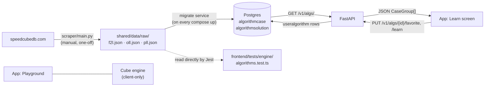

# Architecture

How CubeTutor fits together **as the code stands today**. Planned work lives in [`ROADMAP.md`](../ROADMAP.md), not here.

## Components

| Component | Stack | Code | Runs as |
|---|---|---|---|
| App | Expo SDK 58 (React Native 0.88 + react-native-web), expo-router, Zustand, react-three-fiber, axios | [`frontend/`](../frontend/) | `npm run web` (:8081) or Expo Go |
| API | FastAPI + SQLModel, JWT auth (PyJWT, passlib/bcrypt) | [`backend/app/`](../backend/app/) | `backend` container, uvicorn :8000 |
| Database | Postgres 18 | — | `postgres` container (host :5433) |
| Migrate + seed | Alembic + [`seed/seed_algorithms.py`](../backend/seed/seed_algorithms.py) | [`backend/`](../backend/) | `migrate` container: one-shot, on every `up` |
| Scraper | requests + BeautifulSoup | [`scraper/`](../scraper/) | Run by hand, once; not in Compose |
| Admin | pgAdmin 4 | — | `pgadmin` container (:5050) |

Services and ports: [`docker-compose.yml`](../docker-compose.yml), env vars in [`.template.env`](../.template.env).

**Background jobs** ([ADR 0008](decisions/0008-service-bus-jobs.md), replacing Celery): `POST /v1/jobs` commits a `job` row and sends `{job_id, type}` on a `JobQueue`, and clients poll `GET /v1/jobs/{id}`. The worker (24b) receives in peek-lock mode, runs the handler for the job's `type`, records the outcome on the row and then completes, abandons (retry) or dead-letters the message; a drain marks dead-lettered jobs `failed`. Today the queue is an in-process `InMemoryJobQueue` and there's no worker process yet, so jobs posted to a running API stay `pending`. Azure Service Bus (emulator locally) and `python -m app.worker` come in 24c. Details: [backend.md § Jobs](backend.md#jobs).

**One image, two commands** ([ADR 0005](decisions/0005-one-python-package-uv.md)). [`backend/Dockerfile`](../backend/Dockerfile) builds one image from the repo root (it copies `shared/data/raw` for the seed). It runs as `migrate` (`alembic upgrade head && python -m seed.seed_algorithms`) and `backend` (uvicorn). `backend` starts only after `migrate` exits 0. The image needs only env vars, no bind mounts. In Compose, `backend` alone also mounts `./backend:/app` and runs uvicorn with `--reload` for development. Dependencies: [`backend/pyproject.toml`](../backend/pyproject.toml) + `uv.lock`.

## Data flow: scrape → app

1. **Scrape.** [`scraper/main.py`](../scraper/main.py) fetches the F2L, OLL and PLL pages and writes one JSON file per subset into `shared/data/raw/`. See [data-pipeline.md](data-pipeline.md).
2. **Seed.** [`backend/seed/seed_algorithms.py`](../backend/seed/seed_algorithms.py) loads the three files into the `algorithmcase` and `algorithmsolution` tables. The `migrate` service runs it on every `docker compose up`, after the migrations. It is idempotent.
3. **Serve.** `GET /v1/algs/` returns every case with its solutions, plus the caller's favorite/learned flags. See [backend.md](backend.md).
4. **Show.** The Learn screen ([`frontend/app/(tabs)/learn.tsx`](../frontend/app/%28tabs%29/learn.tsx)) lists them. Toggling favorite/learned updates the UI optimistically and sends a `PUT` with the new value (idempotent, so a retry can't flip it back) ([`SolutionDetail.tsx`](../frontend/features/learn/components/SolutionDetail.tsx)).
5. **Test.** The engine's Jest tests read the same raw JSON directly and check that every scraped solution solves its setup. See [cube-engine.md](cube-engine.md#how-the-tests-pin-the-conventions).

The **3D cube (Playground)** is entirely client-side. It doesn't call the API. See [cube-engine.md](cube-engine.md) and [rendering.md](rendering.md).

## Frontend structure

| Path | What |
|---|---|
| [`app/_layout.tsx`](../frontend/app/_layout.tsx) | Root layout: runs `checkToken()` on start and redirects between `(auth)` and `(tabs)` based on the token |
| [`app/index.tsx`](../frontend/app/index.tsx) | Redirects to `/(auth)/login`. Signed-in users are then sent on to `/(tabs)/playground` by the root layout |
| `app/(auth)/` | Login and register screens |
| `app/(tabs)/` | `learn.tsx` (algorithm list) and `playground.tsx` (the 3D cube) |
| [`features/auth/`](../frontend/features/auth/) | Zustand auth store, token storage (SecureStore on native, localStorage on web), API calls |
| [`features/learn/`](../frontend/features/learn/) | Algorithm list components and API calls |
| [`features/cube/`](../frontend/features/cube/) | Engine, parser, store, input, rendering |
| [`shared/api/client.ts`](../frontend/shared/api/client.ts) | axios instance: base URL from `EXPO_PUBLIC_API_URL`, attaches the bearer token, signs out on 401 |

- **No tab bar:** `app/(tabs)/` has no `_layout.tsx`. After sign-in the root layout routes to `/(tabs)/playground`.
- **Open question:** how is a user meant to reach the Learn screen today? I found no in-app link or navigator; on web it is reachable by URL.

## Cross-cutting facts

- **Auth tokens:** the backend issues access + refresh tokens, but the app keeps only the access token. The app signs out on any 401 instead of refreshing. See [backend.md](backend.md#auth-flow).
- **CORS:** allows the origins in the `CORS_ORIGINS` env var ([configuration](backend.md#configuration)); in Compose that defaults to `http://localhost:8081` and `:8080`. Native apps aren't subject to CORS.
- **Schema creation:** Alembic only. The backend container runs `alembic upgrade head` before uvicorn; the app never creates tables. See [backend.md](backend.md#migrations).
