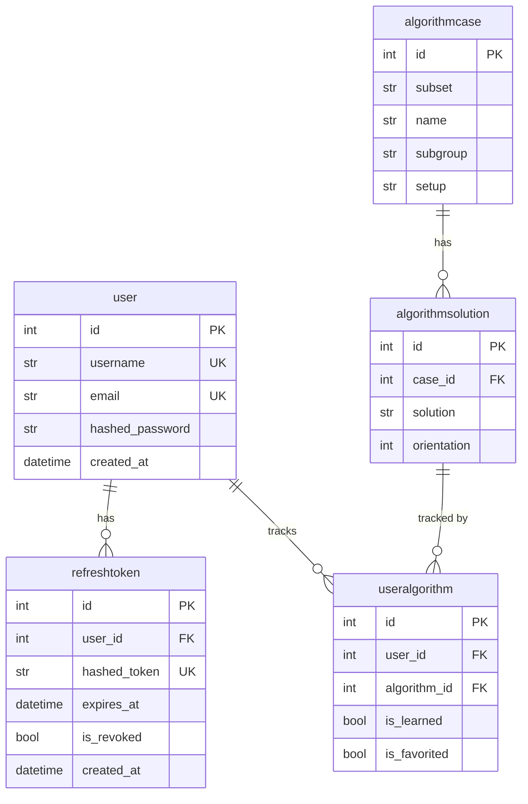

# Backend

FastAPI app in [`backend/app/`](../backend/app/): `main.py` (app, CORS, routers) · `core/` (settings, DB, security, dependencies) · `models/` (SQLModel tables) · `api/routes/` + `api/schemas/` (endpoints and Pydantic I/O). Interactive docs at http://localhost:8000/docs when Compose is up.

Configuration ([`core/settings.py`](../backend/app/core/settings.py)): `DATABASE_URL` and `SECRET_KEY` are required (from the environment or `.env`). `ENV` and `DEBUG` are defined, but nothing reads them. The engine runs with `echo=True` ([`core/db.py`](../backend/app/core/db.py)), so every SQL statement is logged.

## Data model

Tables are SQLModel classes in [`backend/app/models/`](../backend/app/models/). Table names are SQLModel's defaults (lower-cased class names).



| Table | Notes |
|---|---|
| [`user`](../backend/app/models/user.py) | `username` and `email` unique (max 255) |
| [`refreshtoken`](../backend/app/models/refresh_token.py) | Stores a **bcrypt hash** of the refresh JWT, never the raw token |
| [`algorithmcase`](../backend/app/models/algorithm_case.py) | One scraped case. `subset` = F2L/OLL/PLL; `setup` = algorithm that creates the case from solved |
| [`algorithmsolution`](../backend/app/models/algorithm_solution.py) | One solution string per row; `orientation` from the scrape |
| [`useralgorithm`](../backend/app/models/user_algorithm.py) | Per-user flags. `algorithm_id` points at **`algorithmsolution`**, not the case |

- **Open question:** `useralgorithm` has no unique constraint on `(user_id, algorithm_id)`. The routes look a row up before inserting, but nothing stops a duplicate from two concurrent requests.
- **Open question:** `algorithmcase` and `algorithmsolution` have no unique constraints either. The seed's idempotency relies on lookups, not the schema.

## Auth flow

Code: [`api/routes/auth.py`](../backend/app/api/routes/auth.py), [`core/security.py`](../backend/app/core/security.py), [`core/dependencies.py`](../backend/app/core/dependencies.py).

- **Passwords:** bcrypt via passlib. Request schemas take `SecretStr`; passwords must be 8–255 characters and usernames at least 3 ([`api/schemas/auth.py`](../backend/app/api/schemas/auth.py)).
- **Tokens:** HS256 JWTs signed with `SECRET_KEY`. Payload is `{sub: user_id, exp, type}`, where `type` is `"access"` (15 min) or `"refresh"` (7 days). Each decoder rejects the other type.
- **Register / login** return `{access_token, refresh_token, token_type: "bearer"}`, and store a hashed refresh-token row.
- **Refresh** (rotation): decode → load the user's non-revoked token rows → `bcrypt.verify` against each until one matches. If the match has expired it is deleted and the request gets a 401. Otherwise it is marked revoked and a new pair is issued.
- **Logout:** marks the matching refresh row revoked. Returns 200 `"Already logged out"` if the token doesn't decode.
- **Protected routes** use `get_current_user`. It takes a bearer token (`OAuth2PasswordBearer(tokenUrl="/v1/auth/login")`), decodes the access JWT and loads the `User`. Any failure is a 401.
- Refresh and logout verify bcrypt against every live token the user has, so cost grows with the number of active sessions. Expired rows are only removed when someone presents that exact expired token.
- **A rotated refresh token keeps working.** bcrypt reads only the first 72 bytes of its input. For these JWTs that's the header plus `{"sub":"<id>","exp":` and all but the last digit of `exp`, so a user's tokens minted within the same 10-second window hash the same. After a refresh, the old token matches the new row and is accepted. Tokens also have no `jti`, so two minted in the same second are identical strings. Both are pinned by strict-xfail tests in `backend/tests/test_auth.py` (fix: ROADMAP 4e).

How the app uses this today ([`features/auth/`](../frontend/features/auth/), [`shared/api/client.ts`](../frontend/shared/api/client.ts)):

- **It stores only the access token.** Login and register call `signIn(data.access_token)` and discard the refresh token.
- On any 401 the client signs out and redirects to login. **It never calls `/refresh` or `/logout`**, so a session lasts at most 15 minutes.
- On startup, `checkToken()` drops a stored token whose `exp` has passed.

## API endpoints

All routers are included in [`main.py`](../backend/app/main.py). This is the complete list.

| Method | Path | Auth | Request → Response | Code |
|---|---|---|---|---|
| POST | `/v1/auth/register` | — | `{email, username, password}` → `TokenResponse`. 400 if email or username taken | [`auth.py`](../backend/app/api/routes/auth.py) |
| POST | `/v1/auth/login` | — | `{username, password}` (JSON, not form data) → `TokenResponse`. 401 on bad credentials | `auth.py` |
| POST | `/v1/auth/logout` | — (refresh token in body) | `{refresh_token}` → `{detail}` | `auth.py` |
| POST | `/v1/auth/refresh` | — (refresh token in body) | `{refresh_token}` → `TokenResponse` (rotated). 401 if invalid, revoked or expired | `auth.py` |
| GET | `/v1/algs/` | Bearer | → `CaseGroup[]`: `{case_id, case_name, subset, subgroup, setup, solutions: [{solution_id, notation, orientation, is_favorited, is_learned}]}`. One query: solution ⋈ case ⟕ the user's `useralgorithm` | [`algs.py`](../backend/app/api/routes/algs.py) |
| POST | `/v1/algs/{alg_id}/favorite` | Bearer | → `{algorithm_id, is_favorited}`. **Toggles**; creates the link row on first use. 404 if no such solution | `algs.py` |
| POST | `/v1/algs/{alg_id}/learn` | Bearer | → `{algorithm_id, is_learned}`. Toggles, same as favorite | `algs.py` |
| POST | `/v1/images/upload` | — | No body → `{task_id, status: "queued"}`. Enqueues `process_image("fake data!")` | [`images.py`](../backend/app/api/routes/images.py) |

- `alg_id` is an **`algorithmsolution.id`**, not a case id.
- **Open question:** the Swagger "Authorize" button points at `/v1/auth/login`, which expects JSON. Login through the Swagger OAuth2 form (form-encoded) probably fails. I haven't verified this.
- **Open question:** `/v1/images/upload` is unauthenticated, takes no file, and has no endpoint for checking the task status. It looks like a scaffold for the scan pipeline (see [data-pipeline.md](data-pipeline.md#celery-tasks)).

## Tests

pytest suite in [`backend/tests/`](../backend/tests/), run on the host with `backend/.venv` (`/verify` does this). Config lives in [`backend/pyproject.toml`](../backend/pyproject.toml), and dev tools in [`backend/requirements-dev.txt`](../backend/requirements-dev.txt).

```powershell
cd backend
.venv\Scripts\python -m pip install -r requirements-dev.txt
.venv\Scripts\python -m pytest -q
.venv\Scripts\python -m ruff check .
```

- **Database:** a real Postgres database, `cubetutor_test`, on the Compose server. The URL is `TEST_DATABASE_URL` if set (CI), otherwise it's built from `POSTGRES_USER` / `POSTGRES_PASSWORD` / `POSTGRES_HOST_PORT` in the repo-root `.env` on `localhost`. The database is created if missing. If Postgres is unreachable, the run stops with one error naming the URL.
- **Isolation from dev data:** [`conftest.py`](../backend/tests/conftest.py) sets `DATABASE_URL` to the test URL *before* importing `app`, so the app's own engine (built at import time in `core/db.py`) points at the test database. It refuses to run if the database name doesn't end in `_test` or equals the dev database's name.
- **Schema and cleanup:** once per session, `DROP SCHEMA public CASCADE` (which also drops `alembic_version`) then `alembic upgrade head`, so every run builds the DB from the real migrations. After each test, `TRUNCATE … RESTART IDENTITY CASCADE` on every model table. Tests don't depend on order.
- **Migrations:** [`test_migrations.py`](../backend/tests/test_migrations.py) runs `alembic check` (fails if a model changed without a migration) and walks `downgrade base` → `upgrade head`.
- **Clock:** an autouse fixture replaces `datetime` in `app.core.security` with a clock that steps one second per `now()` call from a 10-second boundary, so tokens are distinct and the known token bugs (see Auth flow) reproduce deterministically.
- **Fixtures:** `client`, `session`, `tokens` / `auth_headers` (registered user `alice`), `algs` (2 cases, 3 solutions). Helpers `register()` and `bearer()` are in `tests/helpers.py`.
- **Known bugs** are `xfail(strict=True)` with the fixing sub-step in the reason. When fixed they XPASS and fail the run, so the marker has to come off.
- **Lint:** ruff's default rules plus `I` (import sorting). FastAPI `Depends` and friends are allowed in argument defaults. Migrations are linted too; `alembic/versions/` only ignores F401, since the template always imports `sqlmodel`, and `alembic` is marked third-party so the local `alembic/` folder doesn't confuse import sorting.
- **Not covered:** `/v1/images/upload` (needs Celery/Redis; Phase 24).

## Migrations

Alembic is the only thing that creates or changes tables ([`alembic/env.py`](../backend/alembic/env.py) targets `SQLModel.metadata` and reads `DATABASE_URL` from settings).

- **On startup:** the Compose backend command is `alembic upgrade head && exec uvicorn …`. If the migration fails, uvicorn never starts and the container exits (and restarts) with the Alembic error in its log. At head, the upgrade is a no-op.
- **History:** one baseline, [`a92565855791_baseline.py`](../backend/alembic/versions/a92565855791_baseline.py), autogenerated from the models: the five tables, the unique `ix_refreshtoken_hashed_token` index, and the `user.username` / `user.email` unique constraints. Foreign keys and unique constraints use Postgres's default names (no naming convention).
- **Adding a migration:** see [`backend/CLAUDE.md`](../backend/CLAUDE.md#changing-the-schema). The new template ([`script.py.mako`](../backend/alembic/script.py.mako)) produces ruff-clean files.

### Moving a pre-4b database onto the baseline

Databases built before 4b got their tables from `create_all` and are stamped with the deleted revision `e21c1e12ed8e`, so `alembic upgrade head` fails with "Can't locate revision". The schema already matches the baseline, so stamp it once instead of migrating. Use `run`, not `exec`, because the backend container can't start until this is done:

```powershell
docker compose run --rm --no-deps backend alembic stamp --purge head   # replace the stale version row
docker compose run --rm --no-deps backend alembic check                # expect "No new upgrade operations detected."
docker compose up -d
```

If `check` reports differences, the database drifted from the models. Rebuild it (`docker compose down -v`, then seed) instead of stamping.
