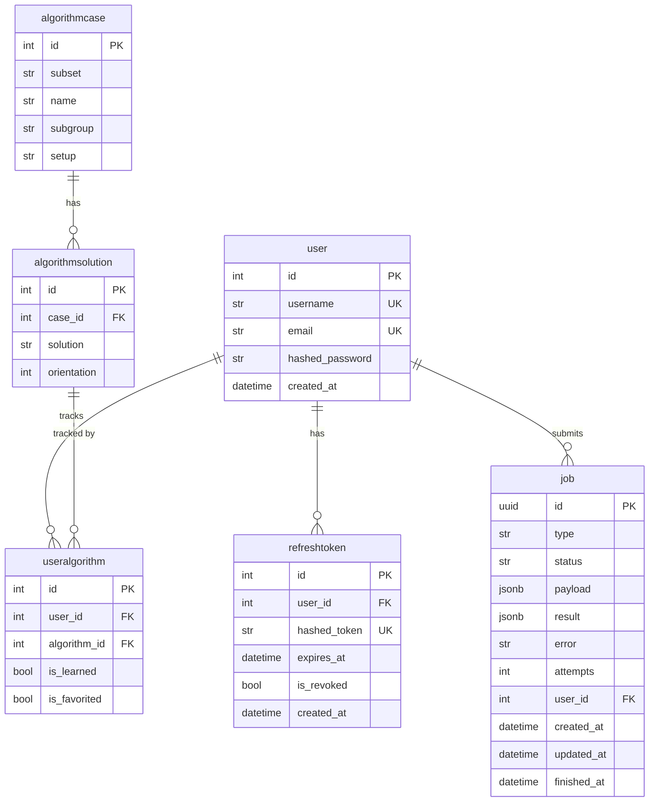

# Backend

FastAPI app in [`backend/app/`](../backend/app/): `main.py` (app, CORS, routers) · `core/` (settings, DB, security, dependencies) · `models/` (SQLModel tables) · `api/routes/` + `api/schemas/` (endpoints and Pydantic I/O). Interactive docs at http://localhost:8000/docs when Compose is up.

## Configuration

Every environment-specific value is an env var read by [`core/settings.py`](../backend/app/core/settings.py) (pydantic-settings; a `.env` in the working directory is also read). Required settings have no default, so a missing one stops the process at import. Nothing environment-specific is in code. In Compose, the app containers get these from the repo-root `.env`. [`docker-compose.yml`](../docker-compose.yml) supplies dev fallbacks for the optional ones, and [`.template.env`](../.template.env) lists them all.

| Variable | Default | Read by | Notes |
|---|---|---|---|
| `DATABASE_URL` | required | engine ([`core/db.py`](../backend/app/core/db.py)), health probe, Alembic `env.py`, seed | `postgresql://…` (psycopg2) |
| `SECRET_KEY` | required | [`core/security.py`](../backend/app/core/security.py) | HS256 signing key for JWTs |
| `CORS_ORIGINS` | `[]` (no browser origins) | [`main.py`](../backend/app/main.py) | Comma-separated (`http://a,http://b`) or a JSON list. Compose fallback `http://localhost:8081,http://localhost:8080` (Expo web) |
| `CORS_ORIGIN_REGEX` | unset (exact list only) | `main.py` | Extra origins by regex (Starlette full-matches it; anchor it anyway). Compiled at startup, so a bad pattern stops the process. Set only in **dev** on Azure, for the Static Web App's PR preview hosts ([infra.md](infra.md#secrets)) |
| `SQL_ECHO` | `false` | `core/db.py` | `true` logs every SQL statement |
| `APPLICATIONINSIGHTS_CONNECTION_STRING` | unset (no telemetry) | [`core/telemetry.py`](../backend/app/core/telemetry.py) | Turns on the Azure Monitor OpenTelemetry distro (see [Telemetry](#telemetry)). Set by Bicep on Azure only |
| `OTEL_SERVICE_NAME` | `unknown_service` | the distro | Cloud role name in App Insights; Azure sets `cubetutor-api` |
| `OTEL_TRACES_SAMPLER` / `OTEL_TRACES_SAMPLER_ARG` | distro default: rate-limited, 5 traces/s | the distro | Azure sets `microsoft.fixed_percentage` and the ratio (`tracesSampleRatio` in `main.bicep`, default `1.0`) |
| `OTEL_PYTHON_FASTAPI_EXCLUDED_URLS` | `health/.*` (set by `core/telemetry.py` if unset) | FastAPI instrumentation | Requests not traced |

The Compose-only variables (`POSTGRES_*`, `*_HOST_PORT`, `PGADMIN_*`) configure the containers, not the app. `TEST_DATABASE_URL` is read only by the tests (see [Tests](#tests)).

`main.py` builds the app with `create_app(settings)`; the module-level `app` uses the env settings, and tests can build one with other settings.

## Telemetry

[`core/telemetry.py`](../backend/app/core/telemetry.py) `configure_telemetry(settings)` calls `configure_azure_monitor()` from `azure-monitor-opentelemetry`. That's the distro: the OpenTelemetry SDK, the App Insights exporter, and a set of instrumentations. We keep psycopg2 and logging, turn off its FastAPI and HTTP-client ones (`DISABLED_INSTRUMENTATIONS`), and instrument FastAPI ourselves right after (see *Not recorded* below).

- **Only when `APPLICATIONINSIGHTS_CONNECTION_STRING` is set.** Otherwise it returns at once, and the SDK isn't even imported. Locally, in Compose and in pytest there is no telemetry.
- **Once per process, before the app is built.** `main.py` calls it at module level, just before `app = create_app(settings)`. The FastAPI instrumentation patches the `FastAPI` class, so it has to come first. It's never called inside `create_app`, because tests build many apps. A module flag makes a second call a no-op. The instrumentation replaces the `fastapi.FastAPI` attribute with a traced subclass, so `create_app` calls `fastapi.FastAPI(...)` (looked up at call time) rather than a `FastAPI` name imported earlier. Otherwise the app would silently not be traced (`test_create_app_uses_the_patched_fastapi_class`).
- **What's captured:** every request as a *request* (route, status, duration, and exceptions raised in it), with each Postgres query under it as a *SQL dependency* (psycopg2), and Python `logging` records as traces.
- **Not recorded**, all to protect the Log Analytics daily cap:
  - **Health probes.** `/health/*` is excluded from the FastAPI instrumentation. `/health/ready` also runs its `SELECT 1` inside `suppress_instrumentation()`, or that query would be sent as an orphan dependency every 10 s.
  - **ASGI `send` / `receive` spans.** By default the FastAPI instrumentation records each request's internal send/receive steps as extra `http send` / `http receive` dependencies. The distro instruments FastAPI without options, so its instrumentation is turned off and `_instrument_fastapi()` instruments it with `exclude_spans=["receive", "send"]`. One request = one span (`test_request_has_no_send_receive_spans`).
  - **The SDK's own HTTP calls.** The exporter polls `/AzMonSDKDynamicConfiguration` with `requests`, which the distro's `requests` instrumentation recorded as dependencies. The app makes no outbound HTTP calls, so the requests/urllib/urllib3/httpx instrumentations are off. **Turn them back on** (remove them from `DISABLED_INSTRUMENTATIONS`) when a feature adds outbound HTTP.
- The distro adds ~35 MB to the image (209 → 244 MB).
- Finding a trace in Azure: [infra.md § Telemetry](infra.md#telemetry).

## Data model

Tables are SQLModel classes in [`backend/app/models/`](../backend/app/models/). Table names are SQLModel's defaults (lower-cased class names).



| Table | Notes |
|---|---|
| [`user`](../backend/app/models/user.py) | `username` and `email` unique (max 255) |
| [`refreshtoken`](../backend/app/models/refresh_token.py) | Stores the hex **sha256** of the refresh JWT (`hashed_token`, unique index), never the raw token. Looked up by that hash |
| [`algorithmcase`](../backend/app/models/algorithm_case.py) | One scraped case. `subset` = F2L/OLL/PLL; `setup` = algorithm that creates the case from solved. Unique `(subset, name, subgroup)` (`uq_algorithmcase_subset_name_subgroup`) |
| [`algorithmsolution`](../backend/app/models/algorithm_solution.py) | One solution string per row; `orientation` from the scrape. Unique `(case_id, solution)` (`uq_algorithmsolution_case_solution`) |
| [`useralgorithm`](../backend/app/models/user_algorithm.py) | Per-user flags. `algorithm_id` points at **`algorithmsolution`**, not the case. Unique `(user_id, algorithm_id)` (`uq_useralgorithm_user_algorithm`): at most one link row per user and solution, which the flag endpoints upsert on |
| [`job`](../backend/app/models/job.py) | One background job ([§ Jobs](#jobs)). `id` is a `uuid4` set by the app. `status` is a VARCHAR checked by `ck_job_status` (`pending`/`running`/`done`/`failed`), not a Postgres ENUM. `payload`/`result` are JSONB. `updated_at` is bumped on every ORM update. Indexes: `ix_job_status_updated_at` (the sweeper), `ix_job_user_id` |

- **Duplicates are ruled out by the schema (4f).** The three unique constraints above are named explicitly in the models (`__table_args__`), so `alembic check` and downgrades stay stable. The seed still checks with lookups first; switching it to `ON CONFLICT DO NOTHING` is a follow-up.

## Jobs

Background work ([ADR 0008](decisions/0008-service-bus-jobs.md), ROADMAP §3.10). Code: [`app/jobs/`](../backend/app/jobs/), [`api/routes/jobs.py`](../backend/app/api/routes/jobs.py).

```mermaid
sequenceDiagram
    participant C as Client
    participant A as API
    participant DB as Postgres
    participant Q as JobQueue
    C->>A: POST /v1/jobs {type, payload}
    A->>DB: INSERT job (pending), COMMIT
    A->>Q: send {job_id, type}
    A-->>C: 202 {id, status: pending}
    Note over A,Q: send fails → still 202; the sweeper re-sends later
    C->>A: GET /v1/jobs/{id}
    A->>DB: SELECT … WHERE id = :id AND user_id = :me
    A-->>C: 200 {status, result, error, attempts} or 404
```

- **The row is the source of truth;** the queue carries only `{job_id, type}` ([`queue.py`](../backend/app/jobs/queue.py) `JobMessage`).
- **Submittable types** are the `JobCreate` schema ([`api/schemas/job.py`](../backend/app/api/schemas/job.py)): today only `diagnostic.echo` with `{message, fail?: "transient" | "permanent"}`, extra keys rejected. Anything else is a 422 before any DB work. Worker-only types are simply left out of the schema.
- **Enqueue** ([`service.py`](../backend/app/jobs/service.py) `enqueue`): commit, then send. A send error is logged and the request still returns 202; the job stays `pending`.
- **Sweeper** (`resend_stale_pending(older_than)`): re-sends `pending` jobs whose `updated_at` is strictly older than the threshold and touches `updated_at`, so the next sweep waits another threshold. Never re-sends `running`/`done`/`failed`. Duplicates are fine: delivery is at-least-once and the worker is idempotent. Nothing calls it on a schedule yet (the worker loop does, in 24b).
- **`JobQueue` contract** (Service Bus peek-lock; see the `queue.py` docstring): `send`; `receive(max_wait)` locks a message for `lock_duration` and returns a `ReceivedMessage` (`lock_token`, `delivery_count`, `locked_until`); settle it with `complete`, `abandon` or `dead_letter(reason)`; `renew_lock` extends it; acting on an expired or settled lock raises `LockLostError`. A message abandoned or expired on its `max_delivery_count`-th delivery goes to the dead-letter queue with reason `MaxDeliveryCountExceeded`. `receive_dead_lettered` reads the DLQ the same way.
- **`InMemoryJobQueue`** ([`memory.py`](../backend/app/jobs/memory.py)) implements it in one process, with an injectable clock so tests never sleep. `get_job_queue` ([`deps.py`](../backend/app/jobs/deps.py)) returns one process-wide instance; tests override it.
- **Today (24a) there is no worker**, so a job posted to a running API stays `pending`. 24b adds the worker loop and handlers, 24c `ServiceBusJobQueue` + the emulator, 24d Azure.

## Auth flow

Code: [`api/routes/auth.py`](../backend/app/api/routes/auth.py), [`core/security.py`](../backend/app/core/security.py), [`core/dependencies.py`](../backend/app/core/dependencies.py).

- **Passwords:** bcrypt via passlib. Request schemas take `SecretStr`; passwords must be 8–255 characters and usernames at least 3 ([`api/schemas/auth.py`](../backend/app/api/schemas/auth.py)).
- **Tokens:** HS256 JWTs signed with `SECRET_KEY`. Payload is `{sub: user_id, exp, type, jti}`, where `type` is `"access"` (15 min) or `"refresh"` (7 days) and `jti` is a random `uuid4().hex`, so every token is unique even when two are minted in the same second. Each decoder rejects the other type.
- **Refresh-token storage:** the row holds `sha256(token)` as hex. bcrypt isn't used here: the token is an HMAC-signed JWT carrying a random `jti` (uuid4, 122 random bits), so there's no low-entropy secret to brute-force, and a deterministic hash allows one indexed equality lookup. It also covers the whole token, where bcrypt reads only the first 72 bytes. No timing-safe compare is needed, because the database matches on the full hash. Passwords stay on bcrypt.
- **Register / login** return `{access_token, refresh_token, token_type: "bearer"}`, and store a hashed refresh-token row. Register keeps its SELECT pre-checks for the friendly error. If a concurrent registration wins the race, the `user` unique constraint raises `IntegrityError`; the route rolls back and returns the same 400 (`user_email_key` → "Email already registered", `user_username_key` → "Username already registered").
- **Refresh** (rotation): decode → look up the row by `sha256(token)` (one query) → reject with 401 unless it belongs to `sub`, isn't revoked and hasn't expired. The row is then marked revoked and a new pair is issued, so a rotated token can't be reused.
- **Cleanup:** login and a successful refresh delete that user's rows whose `expires_at` has passed, revoked or not. There's no scheduled cleanup job (the job system in [§ Jobs](#jobs) has no scheduler yet).
- **Logout:** looks the row up the same way and marks it revoked. Returns 200 `"Logged out"` whether or not a live row matched, and `"Already logged out"` if the token doesn't decode.
- **Protected routes** use `get_current_user`. It takes a bearer token (`OAuth2PasswordBearer(tokenUrl="/v1/auth/login")`), decodes the access JWT and loads the `User`. Any failure is a 401.
- **Not done yet:** reuse detection (presenting a revoked token doesn't revoke the user's other tokens).

How the app uses this today ([`features/auth/`](../frontend/features/auth/), [`shared/api/client.ts`](../frontend/shared/api/client.ts)):

- **It stores only the access token.** Login and register call `signIn(data.access_token)` and discard the refresh token.
- On any 401 the client signs out and redirects to login. **It never calls `/refresh` or `/logout`**, so a session lasts at most 15 minutes.
- On startup, `checkToken()` drops a stored token whose `exp` has passed.

## API endpoints

All routers are included in [`main.py`](../backend/app/main.py). This is the complete list.

| Method | Path | Auth | Request → Response | Code |
|---|---|---|---|---|
| POST | `/v1/auth/register` | — | `{email, username, password}` → `TokenResponse`. 400 if email or username taken | [`auth.py`](../backend/app/api/routes/auth.py) |
| POST | `/v1/auth/login` | — | `{username, password}` (JSON, not form data) → `TokenResponse`. 401 on bad credentials | `auth.py` |
| POST | `/v1/auth/logout` | — (refresh token in body) | `{refresh_token}` → `{detail}` | `auth.py` |
| POST | `/v1/auth/refresh` | — (refresh token in body) | `{refresh_token}` → `TokenResponse` (rotated). 401 if invalid, revoked or expired | `auth.py` |
| GET | `/v1/algs/?subset=` | Bearer | → `CaseGroup[]`: `{case_id, case_name, subset, subgroup, setup, solutions: [{solution_id, notation, orientation, is_favorited, is_learned}]}`. One query: solution ⋈ case ⟕ the user's `useralgorithm`, `ORDER BY subset, case.id, solution.id` (stable between calls). Optional `subset` = `F2L` \| `OLL` \| `PLL` (case-sensitive); anything else → 422 | [`algs.py`](../backend/app/api/routes/algs.py) |
| PUT | `/v1/algs/{alg_id}/favorite` | Bearer | `{value: bool}` → `{algorithm_id, is_favorited}`. **Sets** the flag (idempotent): one `INSERT … ON CONFLICT (user_id, algorithm_id) DO UPDATE` that creates the link row on first use (the other flag starts false) and otherwise updates only this flag. 404 if no such solution, 422 if `value` is missing or not a JSON boolean | `algs.py` |
| PUT | `/v1/algs/{alg_id}/learn` | Bearer | `{value: bool}` → `{algorithm_id, is_learned}`. Same as favorite (shared `_set_flag` helper). The old `POST` toggles are gone (405) | `algs.py` |
| POST | `/v1/jobs/` | Bearer | `{type, payload}` → **202** `{id, status: "pending"}`. Only `diagnostic.echo` with `{message, fail?}`; anything else (unknown type, bad or extra fields) → 422 with no row and no message. Still 202 if the queue send fails ([§ Jobs](#jobs)) | [`jobs.py`](../backend/app/api/routes/jobs.py) |
| GET | `/v1/jobs/{job_id}` | Bearer | → `{id, type, status, result, error, attempts, created_at, updated_at, finished_at}`. **404** for another user's job and for an unknown id (same body), so existence isn't revealed. A malformed UUID → 422 | `jobs.py` |
| GET | `/health/live` | — | → `{status: "ok"}`. Never touches the DB (liveness) | [`health.py`](../backend/app/api/routes/health.py) |
| GET | `/health/ready` | — | → 200 `{status: "ok"}` if `SELECT 1` succeeds, else 503 `{status: "unavailable"}` (readiness) | `health.py` |

- `alg_id` is an **`algorithmsolution.id`**, not a case id.
- **Health probes** are unversioned and unauthenticated, for Container Apps probes, the deploy smoke test and the Compose `backend` healthcheck (which calls `/health/ready` with Python's `urllib`, since the slim image has no curl; `docker compose ps` shows `healthy`/`unhealthy`). `ready` uses its own `NullPool` engine with a 2 s connect timeout: every probe opens a fresh connection, a dead DB can't hang it, and it never takes a slot from the app's pool.
- **Open question:** the Swagger "Authorize" button points at `/v1/auth/login`, which expects JSON. Login through the Swagger OAuth2 form (form-encoded) probably fails. I haven't verified this.

## Tests

pytest suite in [`backend/tests/`](../backend/tests/), run on the host with uv (`/verify` does this). Config and the `dev` dependency group (pytest, ruff, httpx) live in [`backend/pyproject.toml`](../backend/pyproject.toml); `uv.lock` pins everything ([ADR 0005](decisions/0005-one-python-package-uv.md)).

```powershell
cd backend
uv sync                      # creates/updates backend/.venv from uv.lock, dev group included
uv run pytest -q
uv run ruff check .
uv run ruff format .        # CI and /verify fail on unformatted code (--check)
```

- **Database:** a real Postgres database, `cubetutor_test`, on the Compose server. The URL is `TEST_DATABASE_URL` if set (CI), otherwise it's built from `POSTGRES_USER` / `POSTGRES_PASSWORD` / `POSTGRES_HOST_PORT` in the repo-root `.env` on `localhost`. The database is created if missing. If Postgres is unreachable, the run stops with one error naming the URL.
- **Isolation from dev data:** [`conftest.py`](../backend/tests/conftest.py) sets `DATABASE_URL` to the test URL *before* importing `app`, so the app's own engine (built at import time in `core/db.py`) points at the test database. It refuses to run if the database name doesn't end in `_test` or equals the dev database's name.
- **Schema and cleanup:** once per session, `DROP SCHEMA public CASCADE` (which also drops `alembic_version`) then `alembic upgrade head`, so every run builds the DB from the real migrations. After each test, `TRUNCATE … RESTART IDENTITY CASCADE` on every model table. Tests don't depend on order.
- **Migrations:** [`test_migrations.py`](../backend/tests/test_migrations.py) runs `alembic check` (fails if a model changed without a migration) and walks `downgrade base` → `upgrade head`.
- **Clock:** no global clock fixture; `jti` makes every token unique. Tests that need same-second tokens monkeypatch `datetime` in `app.core.security` with a frozen clock. Auth tests also cover the stored sha256, the single token lookup (counted with a `before_cursor_execute` listener), expired rows, cleanup on login, and the register race (a `get_session` override whose `select(User)` finds nothing).
- **Config and probes:** [`test_settings.py`](../backend/tests/test_settings.py) (CORS parsing in both forms, `SQL_ECHO` default), [`test_cors.py`](../backend/tests/test_cors.py) (preflight against an app built with `create_app`: the exact list, a preview origin allowed by `CORS_ORIGIN_REGEX` and rejected without it, look-alike origins rejected, a bad regex fails), [`test_telemetry.py`](../backend/tests/test_telemetry.py) (the distro module is replaced by a recorder: not called without a connection string, called once with one, the `/health` exclusion default), [`test_health.py`](../backend/tests/test_health.py) (503 by overriding the `get_probe_engine` dependency with an engine pointed at an unreachable port).
- **Algorithms and constraints:** [`test_algs.py`](../backend/tests/test_algs.py) covers ordering (cases inserted out of order), the `subset` filter and its 422, and the PUT flags (set twice → one row, clear, independence, per-user, 404/401/422, old POST → 405). [`test_constraints.py`](../backend/tests/test_constraints.py) inserts a duplicate for each unique key and checks the `IntegrityError` names the expected constraint.
- **Fixtures:** `client`, `session`, `tokens` / `auth_headers` (registered user `alice`), `algs` (2 cases, 3 solutions). Helpers `register()` and `bearer()` are in `tests/helpers.py`.
- **Known bugs** are `xfail(strict=True)` with the fixing sub-step in the reason. When fixed they XPASS and fail the run, so the marker has to come off.
- **Format:** `ruff format` with its defaults (Black style, line length 88). CI and `/verify` run `ruff format --check`, so run `uv run ruff format .` before pushing. The one-time format pass is listed in [`.git-blame-ignore-revs`](../.git-blame-ignore-revs) so `git blame` skips it (GitHub does this automatically; locally: `git config blame.ignoreRevsFile .git-blame-ignore-revs`).
- **Lint:** ruff's default rules plus `I` (import sorting). FastAPI `Depends` and friends are allowed in argument defaults. Migrations are linted too; `alembic/versions/` only ignores F401, since the template always imports `sqlmodel`, and `alembic` is marked third-party so the local `alembic/` folder doesn't confuse import sorting.
- **Jobs:** [`test_job_queue_memory.py`](../backend/tests/test_job_queue_memory.py) (peek-lock, redelivery, max delivery → DLQ, renew, `LockLostError`, with `FakeClock` from `tests/helpers.py`), [`test_job_service.py`](../backend/tests/test_job_service.py) (commit-then-send, the sweeper's age and status filters), [`test_jobs_api.py`](../backend/tests/test_jobs_api.py) (202/422/401, owner-only 404, a failing send still 202). The queue is swapped with `app.dependency_overrides[get_job_queue]` (a `RecordingQueue` from `tests/helpers.py`, or a fresh `InMemoryJobQueue`).
- **Seed:** [`test_seed.py`](../backend/tests/test_seed.py) seeds a small temp JSON set via `SEED_DATA_DIR` twice and checks the row counts don't change, and checks the default data dir is the repo's `shared/data/raw`.

## Migrations

Alembic is the only thing that creates or changes tables ([`alembic/env.py`](../backend/alembic/env.py) targets `SQLModel.metadata` and reads `DATABASE_URL` from settings).

- **On startup:** the one-shot Compose `migrate` service runs `alembic upgrade head && python -m seed.seed_algorithms` from the backend image. `backend` depends on it with `condition: service_completed_successfully`, so if it fails, the API doesn't start and `docker compose up` reports `service "migrate" didn't complete successfully`. Read the error with `docker compose logs migrate`. At head, the upgrade is a no-op and the seed adds nothing. On Azure the same command runs as the `caj-cubetutor-migrate-<env>` Container Apps Job before each rollout, so migrations must follow the expand → deploy → contract rule ([infra.md](infra.md#how-its-deployed)).
- **History:**
  1. [`a92565855791_baseline.py`](../backend/alembic/versions/a92565855791_baseline.py), autogenerated from the models: the five tables, the unique `ix_refreshtoken_hashed_token` index, and the `user.username` / `user.email` unique constraints. Foreign keys and unique constraints use Postgres's default names (no naming convention).
  2. [`ed0be7ac838e_clear_bcrypt_refresh_tokens.py`](../backend/alembic/versions/ed0be7ac838e_clear_bcrypt_refresh_tokens.py) (4e): data only. It deletes every `refreshtoken` row, since bcrypt hashes can't be converted to sha256, so everyone logs in again once. The downgrade does nothing.
  3. [`3f1c9d2b7a64_unique_constraints.py`](../backend/alembic/versions/3f1c9d2b7a64_unique_constraints.py) (4f): adds the three named unique constraints on `algorithmcase`, `algorithmsolution` and `useralgorithm`. It doesn't dedupe: if duplicates exist, the upgrade fails loudly. The downgrade drops the constraints.
  4. [`b0b44e4b3483_add_job_table.py`](../backend/alembic/versions/b0b44e4b3483_add_job_table.py) (24a): creates `job` with `ck_job_status`, `ix_job_status_updated_at` and `ix_job_user_id`. A new table only (expand step). The downgrade drops it.
- **Adding a migration:** see [`backend/CLAUDE.md`](../backend/CLAUDE.md#changing-the-schema). The new template ([`script.py.mako`](../backend/alembic/script.py.mako)) produces ruff-clean files.

### Moving a pre-4b database onto the baseline

Databases built before 4b got their tables from `create_all` and are stamped with the deleted revision `e21c1e12ed8e`, so `alembic upgrade head` fails with "Can't locate revision". The schema already matches the baseline, so stamp it once instead of migrating. Use `run` on the `migrate` service, because `backend` can't start until this is done:

```powershell
docker compose run --rm migrate alembic stamp --purge head   # replace the stale version row
docker compose run --rm migrate alembic check                # expect "No new upgrade operations detected."
docker compose up -d
```

If `check` reports differences, the database drifted from the models. Rebuild it (`docker compose down -v`, then seed) instead of stamping.
