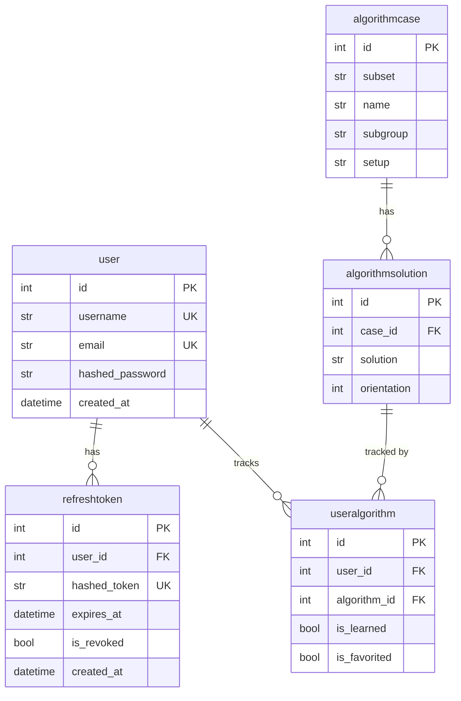

# Backend

FastAPI app in [`backend/app/`](../backend/app/): `main.py` (app, CORS, routers) · `core/` (settings, DB, security, dependencies) · `models/` (SQLModel tables) · `api/routes/` + `api/schemas/` (endpoints and Pydantic I/O). Interactive docs at http://localhost:8000/docs when Compose is up.

## Configuration

Every environment-specific value is an env var read by [`core/settings.py`](../backend/app/core/settings.py) (pydantic-settings; a `.env` in the working directory is also read). Required settings have no default, so a missing one stops the process at import. Nothing environment-specific is in code. In Compose, the app containers get these from the repo-root `.env`. [`docker-compose.yml`](../docker-compose.yml) supplies dev fallbacks for the optional ones, and [`.template.env`](../.template.env) lists them all.

| Variable | Default | Read by | Notes |
|---|---|---|---|
| `DATABASE_URL` | required | engine ([`core/db.py`](../backend/app/core/db.py)), health probe, Alembic `env.py`, seed | `postgresql://…` (psycopg2) |
| `SECRET_KEY` | required | [`core/security.py`](../backend/app/core/security.py) | HS256 signing key for JWTs |
| `CELERY_BROKER_URL` | required | [`worker/celery_app.py`](../backend/app/worker/celery_app.py) | Compose fallback `redis://redis:6379/0` |
| `CELERY_RESULT_BACKEND` | required | `worker/celery_app.py` | Compose fallback `redis://redis:6379/1` |
| `CORS_ORIGINS` | `[]` (no browser origins) | [`main.py`](../backend/app/main.py) | Comma-separated (`http://a,http://b`) or a JSON list. Compose fallback `http://localhost:8081,http://localhost:8080` (Expo web) |
| `SQL_ECHO` | `false` | `core/db.py` | `true` logs every SQL statement |

The Compose-only variables (`POSTGRES_*`, `*_HOST_PORT`, `PGADMIN_*`) configure the containers, not the app. `TEST_DATABASE_URL` is read only by the tests (see [Tests](#tests)).

`main.py` builds the app with `create_app(settings)`; the module-level `app` uses the env settings, and tests can build one with other settings.

## Data model

Tables are SQLModel classes in [`backend/app/models/`](../backend/app/models/). Table names are SQLModel's defaults (lower-cased class names).



| Table | Notes |
|---|---|
| [`user`](../backend/app/models/user.py) | `username` and `email` unique (max 255) |
| [`refreshtoken`](../backend/app/models/refresh_token.py) | Stores the hex **sha256** of the refresh JWT (`hashed_token`, unique index), never the raw token. Looked up by that hash |
| [`algorithmcase`](../backend/app/models/algorithm_case.py) | One scraped case. `subset` = F2L/OLL/PLL; `setup` = algorithm that creates the case from solved. Unique `(subset, name, subgroup)` (`uq_algorithmcase_subset_name_subgroup`) |
| [`algorithmsolution`](../backend/app/models/algorithm_solution.py) | One solution string per row; `orientation` from the scrape. Unique `(case_id, solution)` (`uq_algorithmsolution_case_solution`) |
| [`useralgorithm`](../backend/app/models/user_algorithm.py) | Per-user flags. `algorithm_id` points at **`algorithmsolution`**, not the case. Unique `(user_id, algorithm_id)` (`uq_useralgorithm_user_algorithm`): at most one link row per user and solution, which the flag endpoints upsert on |

- **Duplicates are ruled out by the schema (4f).** The three unique constraints above are named explicitly in the models (`__table_args__`), so `alembic check` and downgrades stay stable. The seed still checks with lookups first; switching it to `ON CONFLICT DO NOTHING` is a follow-up.

## Auth flow

Code: [`api/routes/auth.py`](../backend/app/api/routes/auth.py), [`core/security.py`](../backend/app/core/security.py), [`core/dependencies.py`](../backend/app/core/dependencies.py).

- **Passwords:** bcrypt via passlib. Request schemas take `SecretStr`; passwords must be 8–255 characters and usernames at least 3 ([`api/schemas/auth.py`](../backend/app/api/schemas/auth.py)).
- **Tokens:** HS256 JWTs signed with `SECRET_KEY`. Payload is `{sub: user_id, exp, type, jti}`, where `type` is `"access"` (15 min) or `"refresh"` (7 days) and `jti` is a random `uuid4().hex`, so every token is unique even when two are minted in the same second. Each decoder rejects the other type.
- **Refresh-token storage:** the row holds `sha256(token)` as hex. bcrypt isn't used here: the token is an HMAC-signed JWT carrying a random `jti` (uuid4, 122 random bits), so there's no low-entropy secret to brute-force, and a deterministic hash allows one indexed equality lookup. It also covers the whole token, where bcrypt reads only the first 72 bytes. No timing-safe compare is needed, because the database matches on the full hash. Passwords stay on bcrypt.
- **Register / login** return `{access_token, refresh_token, token_type: "bearer"}`, and store a hashed refresh-token row. Register keeps its SELECT pre-checks for the friendly error. If a concurrent registration wins the race, the `user` unique constraint raises `IntegrityError`; the route rolls back and returns the same 400 (`user_email_key` → "Email already registered", `user_username_key` → "Username already registered").
- **Refresh** (rotation): decode → look up the row by `sha256(token)` (one query) → reject with 401 unless it belongs to `sub`, isn't revoked and hasn't expired. The row is then marked revoked and a new pair is issued, so a rotated token can't be reused.
- **Cleanup:** login and a successful refresh delete that user's rows whose `expires_at` has passed, revoked or not. There's no scheduled job yet (Phase 24).
- **Logout:** looks the row up the same way and marks it revoked. Returns 200 `"Logged out"` whether or not a live row matched, and `"Already logged out"` if the token doesn't decode.
- **Protected routes** use `get_current_user`. It takes a bearer token (`OAuth2PasswordBearer(tokenUrl="/v1/auth/login")`), decodes the access JWT and loads the `User`. Any failure is a 401.
- **Not done yet:** reuse detection (presenting a revoked token doesn't revoke the user's other tokens).

How the app uses this today ([`features/auth/`](../frontend/features/auth/), [`shared/api/client.ts`](../frontend/shared/api/client.ts)):

- **It stores only the access token.** Login and register call `signIn(data.access_token)` and discard the refresh token.
- On any 401 the client signs out and redirects to login. **It never calls `/refresh` or `/logout`**, so a session lasts at most 15 minutes.
- On startup, `checkToken()` drops a stored token whose `exp` has passed.

## API endpoints

All routers are included in [`main.py`](../backend/app/main.py). This is the complete list.

| Method | Path | Auth | Request → Response | Code |
|---|---|---|---|---|
| POST | `/v1/auth/register` | — | `{email, username, password}` → `TokenResponse`. 400 if email or username taken | [`auth.py`](../backend/app/api/routes/auth.py) |
| POST | `/v1/auth/login` | — | `{username, password}` (JSON, not form data) → `TokenResponse`. 401 on bad credentials | `auth.py` |
| POST | `/v1/auth/logout` | — (refresh token in body) | `{refresh_token}` → `{detail}` | `auth.py` |
| POST | `/v1/auth/refresh` | — (refresh token in body) | `{refresh_token}` → `TokenResponse` (rotated). 401 if invalid, revoked or expired | `auth.py` |
| GET | `/v1/algs/?subset=` | Bearer | → `CaseGroup[]`: `{case_id, case_name, subset, subgroup, setup, solutions: [{solution_id, notation, orientation, is_favorited, is_learned}]}`. One query: solution ⋈ case ⟕ the user's `useralgorithm`, `ORDER BY subset, case.id, solution.id` (stable between calls). Optional `subset` = `F2L` \| `OLL` \| `PLL` (case-sensitive); anything else → 422 | [`algs.py`](../backend/app/api/routes/algs.py) |
| PUT | `/v1/algs/{alg_id}/favorite` | Bearer | `{value: bool}` → `{algorithm_id, is_favorited}`. **Sets** the flag (idempotent): one `INSERT … ON CONFLICT (user_id, algorithm_id) DO UPDATE` that creates the link row on first use (the other flag starts false) and otherwise updates only this flag. 404 if no such solution, 422 if `value` is missing or not a JSON boolean | `algs.py` |
| PUT | `/v1/algs/{alg_id}/learn` | Bearer | `{value: bool}` → `{algorithm_id, is_learned}`. Same as favorite (shared `_set_flag` helper). The old `POST` toggles are gone (405) | `algs.py` |
| GET | `/health/live` | — | → `{status: "ok"}`. Never touches the DB (liveness) | [`health.py`](../backend/app/api/routes/health.py) |
| GET | `/health/ready` | — | → 200 `{status: "ok"}` if `SELECT 1` succeeds, else 503 `{status: "unavailable"}` (readiness) | `health.py` |
| POST | `/v1/images/upload` | — | No body → `{task_id, status: "queued"}`. Enqueues `process_image("fake data!")` | [`images.py`](../backend/app/api/routes/images.py) |

- `alg_id` is an **`algorithmsolution.id`**, not a case id.
- **Health probes** are unversioned and unauthenticated, for Container Apps probes, the deploy smoke test and the Compose `backend` healthcheck (which calls `/health/ready` with Python's `urllib`, since the slim image has no curl; `docker compose ps` shows `healthy`/`unhealthy`). `ready` uses its own `NullPool` engine with a 2 s connect timeout: every probe opens a fresh connection, a dead DB can't hang it, and it never takes a slot from the app's pool.
- **Open question:** the Swagger "Authorize" button points at `/v1/auth/login`, which expects JSON. Login through the Swagger OAuth2 form (form-encoded) probably fails. I haven't verified this.
- **Open question:** `/v1/images/upload` is unauthenticated, takes no file, and has no endpoint for checking the task status. It looks like a scaffold for the scan pipeline (see [data-pipeline.md](data-pipeline.md#celery-tasks)).

## Tests

pytest suite in [`backend/tests/`](../backend/tests/), run on the host with uv (`/verify` does this). Config and the `dev` dependency group (pytest, ruff, httpx) live in [`backend/pyproject.toml`](../backend/pyproject.toml); `uv.lock` pins everything ([ADR 0005](decisions/0005-one-python-package-uv.md)).

```powershell
cd backend
uv sync                      # creates/updates backend/.venv from uv.lock, dev group included
uv run pytest -q
uv run ruff check .
```

- **Database:** a real Postgres database, `cubetutor_test`, on the Compose server. The URL is `TEST_DATABASE_URL` if set (CI), otherwise it's built from `POSTGRES_USER` / `POSTGRES_PASSWORD` / `POSTGRES_HOST_PORT` in the repo-root `.env` on `localhost`. The database is created if missing. If Postgres is unreachable, the run stops with one error naming the URL.
- **Isolation from dev data:** [`conftest.py`](../backend/tests/conftest.py) sets `DATABASE_URL` to the test URL *before* importing `app`, so the app's own engine (built at import time in `core/db.py`) points at the test database. It refuses to run if the database name doesn't end in `_test` or equals the dev database's name.
- **Schema and cleanup:** once per session, `DROP SCHEMA public CASCADE` (which also drops `alembic_version`) then `alembic upgrade head`, so every run builds the DB from the real migrations. After each test, `TRUNCATE … RESTART IDENTITY CASCADE` on every model table. Tests don't depend on order.
- **Migrations:** [`test_migrations.py`](../backend/tests/test_migrations.py) runs `alembic check` (fails if a model changed without a migration) and walks `downgrade base` → `upgrade head`.
- **Clock:** no global clock fixture; `jti` makes every token unique. Tests that need same-second tokens monkeypatch `datetime` in `app.core.security` with a frozen clock. Auth tests also cover the stored sha256, the single token lookup (counted with a `before_cursor_execute` listener), expired rows, cleanup on login, and the register race (a `get_session` override whose `select(User)` finds nothing).
- **Config and probes:** [`test_settings.py`](../backend/tests/test_settings.py) (CORS parsing in both forms, `SQL_ECHO` default, Celery URLs), [`test_cors.py`](../backend/tests/test_cors.py) (preflight against an app built with `create_app`), [`test_health.py`](../backend/tests/test_health.py) (503 by overriding the `get_probe_engine` dependency with an engine pointed at an unreachable port). `conftest.py` also sets dummy `CELERY_*` URLs, since they're required.
- **Algorithms and constraints:** [`test_algs.py`](../backend/tests/test_algs.py) covers ordering (cases inserted out of order), the `subset` filter and its 422, and the PUT flags (set twice → one row, clear, independence, per-user, 404/401/422, old POST → 405). [`test_constraints.py`](../backend/tests/test_constraints.py) inserts a duplicate for each unique key and checks the `IntegrityError` names the expected constraint.
- **Fixtures:** `client`, `session`, `tokens` / `auth_headers` (registered user `alice`), `algs` (2 cases, 3 solutions). Helpers `register()` and `bearer()` are in `tests/helpers.py`.
- **Known bugs** are `xfail(strict=True)` with the fixing sub-step in the reason. When fixed they XPASS and fail the run, so the marker has to come off.
- **Lint:** ruff's default rules plus `I` (import sorting). FastAPI `Depends` and friends are allowed in argument defaults. Migrations are linted too; `alembic/versions/` only ignores F401, since the template always imports `sqlmodel`, and `alembic` is marked third-party so the local `alembic/` folder doesn't confuse import sorting.
- **Seed:** [`test_seed.py`](../backend/tests/test_seed.py) seeds a small temp JSON set via `SEED_DATA_DIR` twice and checks the row counts don't change, and checks the default data dir is the repo's `shared/data/raw`.
- **Not covered:** `/v1/images/upload` (needs Celery/Redis; Phase 24).

## Migrations

Alembic is the only thing that creates or changes tables ([`alembic/env.py`](../backend/alembic/env.py) targets `SQLModel.metadata` and reads `DATABASE_URL` from settings).

- **On startup:** the one-shot Compose `migrate` service runs `alembic upgrade head && python -m seed.seed_algorithms` from the backend image. `backend` and `celery` depend on it with `condition: service_completed_successfully`, so if it fails, neither starts and `docker compose up` reports `service "migrate" didn't complete successfully`. Read the error with `docker compose logs migrate`. At head, the upgrade is a no-op and the seed adds nothing. The same command is meant to run as the migration job before each rollout on Azure (ROADMAP §3.11).
- **History:**
  1. [`a92565855791_baseline.py`](../backend/alembic/versions/a92565855791_baseline.py), autogenerated from the models: the five tables, the unique `ix_refreshtoken_hashed_token` index, and the `user.username` / `user.email` unique constraints. Foreign keys and unique constraints use Postgres's default names (no naming convention).
  2. [`ed0be7ac838e_clear_bcrypt_refresh_tokens.py`](../backend/alembic/versions/ed0be7ac838e_clear_bcrypt_refresh_tokens.py) (4e): data only. It deletes every `refreshtoken` row, since bcrypt hashes can't be converted to sha256, so everyone logs in again once. The downgrade does nothing.
  3. [`3f1c9d2b7a64_unique_constraints.py`](../backend/alembic/versions/3f1c9d2b7a64_unique_constraints.py) (4f): adds the three named unique constraints on `algorithmcase`, `algorithmsolution` and `useralgorithm`. It doesn't dedupe: if duplicates exist, the upgrade fails loudly. The downgrade drops the constraints.
- **Adding a migration:** see [`backend/CLAUDE.md`](../backend/CLAUDE.md#changing-the-schema). The new template ([`script.py.mako`](../backend/alembic/script.py.mako)) produces ruff-clean files.

### Moving a pre-4b database onto the baseline

Databases built before 4b got their tables from `create_all` and are stamped with the deleted revision `e21c1e12ed8e`, so `alembic upgrade head` fails with "Can't locate revision". The schema already matches the baseline, so stamp it once instead of migrating. Use `run` on the `migrate` service, because `backend` can't start until this is done:

```powershell
docker compose run --rm migrate alembic stamp --purge head   # replace the stale version row
docker compose run --rm migrate alembic check                # expect "No new upgrade operations detected."
docker compose up -d
```

If `check` reports differences, the database drifted from the models. Rebuild it (`docker compose down -v`, then seed) instead of stamping.
