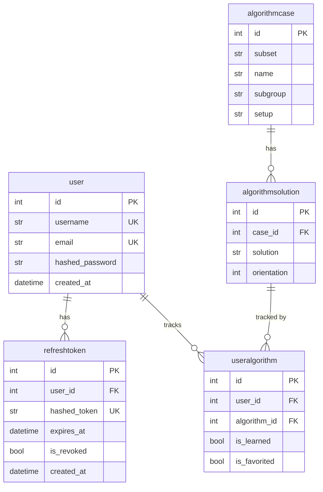

# Backend

FastAPI app in [`backend/app/`](../backend/app/): `main.py` (app, CORS, routers) · `core/` (settings, DB, security, dependencies) · `models/` (SQLModel tables) · `api/routes/` + `api/schemas/` (endpoints and Pydantic I/O). Interactive docs at http://localhost:8000/docs when Compose is up.

Configuration ([`core/settings.py`](../backend/app/core/settings.py)): `DATABASE_URL` and `SECRET_KEY` are required (from the environment or `.env`). `ENV` and `DEBUG` are defined, but nothing reads them. The engine runs with `echo=True` ([`core/db.py`](../backend/app/core/db.py)), so every SQL statement is logged.

## Data model

Tables are SQLModel classes in [`backend/app/models/`](../backend/app/models/). Table names are SQLModel's defaults (lower-cased class names).

| Table | Notes |
|---|---|
| [`user`](../backend/app/models/user.py) | `username` and `email` unique (max 255) |
| [`refreshtoken`](../backend/app/models/refresh_token.py) | Stores a **bcrypt hash** of the refresh JWT, never the raw token |
| [`algorithmcase`](../backend/app/models/algorithm_case.py) | One scraped case. `subset` = F2L/OLL/PLL; `setup` = algorithm that creates the case from solved |
| [`algorithmsolution`](../backend/app/models/algorithm_solution.py) | One solution string per row; `orientation` from the scrape |
| [`useralgorithm`](../backend/app/models/user_algorithm.py) | Per-user flags. `algorithm_id` points at **`algorithmsolution`**, not the case |

- **Open question:** `useralgorithm` has no unique constraint on `(user_id, algorithm_id)`. The routes look a row up before inserting, but nothing stops a duplicate from two concurrent requests.
- **Open question:** `algorithmcase` and `algorithmsolution` have no unique constraints either. The seed's idempotency relies on lookups, not the schema.

## Auth flow

Code: [`api/routes/auth.py`](../backend/app/api/routes/auth.py), [`core/security.py`](../backend/app/core/security.py), [`core/dependencies.py`](../backend/app/core/dependencies.py).

- **Passwords:** bcrypt via passlib. Request schemas take `SecretStr`; passwords must be 8–255 characters and usernames at least 3 ([`api/schemas/auth.py`](../backend/app/api/schemas/auth.py)).
- **Tokens:** HS256 JWTs signed with `SECRET_KEY`. Payload is `{sub: user_id, exp, type}`, where `type` is `"access"` (15 min) or `"refresh"` (7 days). Each decoder rejects the other type.
- **Register / login** return `{access_token, refresh_token, token_type: "bearer"}`, and store a hashed refresh-token row.
- **Refresh** (rotation): decode → load the user's non-revoked token rows → `bcrypt.verify` against each until one matches. If the match has expired it is deleted and the request gets a 401. Otherwise it is marked revoked and a new pair is issued.
- **Logout:** marks the matching refresh row revoked. Returns 200 `"Already logged out"` if the token doesn't decode.
- **Protected routes** use `get_current_user`. It takes a bearer token (`OAuth2PasswordBearer(tokenUrl="/v1/auth/login")`), decodes the access JWT and loads the `User`. Any failure is a 401.
- Refresh and logout verify bcrypt against every live token the user has, so cost grows with the number of active sessions. Expired rows are only removed when someone presents that exact expired token.

How the app uses this today ([`features/auth/`](../frontend/features/auth/), [`shared/api/client.ts`](../frontend/shared/api/client.ts)):

- **It stores only the access token.** Login and register call `signIn(data.access_token)` and discard the refresh token.
- On any 401 the client signs out and redirects to login. **It never calls `/refresh` or `/logout`**, so a session lasts at most 15 minutes.
- On startup, `checkToken()` drops a stored token whose `exp` has passed.

## API endpoints

All routers are included in [`main.py`](../backend/app/main.py). This is the complete list.

| Method | Path | Auth | Request → Response | Code |
|---|---|---|---|---|
| POST | `/v1/auth/register` | — | `{email, username, password}` → `TokenResponse`. 400 if email or username taken | [`auth.py`](../backend/app/api/routes/auth.py) |
| POST | `/v1/auth/login` | — | `{username, password}` (JSON, not form data) → `TokenResponse`. 401 on bad credentials | `auth.py` |
| POST | `/v1/auth/logout` | — (refresh token in body) | `{refresh_token}` → `{detail}` | `auth.py` |
| POST | `/v1/auth/refresh` | — (refresh token in body) | `{refresh_token}` → `TokenResponse` (rotated). 401 if invalid, revoked or expired | `auth.py` |
| GET | `/v1/algs/` | Bearer | → `CaseGroup[]`: `{case_id, case_name, subset, subgroup, setup, solutions: [{solution_id, notation, orientation, is_favorited, is_learned}]}`. One query: solution ⋈ case ⟕ the user's `useralgorithm` | [`algs.py`](../backend/app/api/routes/algs.py) |
| POST | `/v1/algs/{alg_id}/favorite` | Bearer | → `{algorithm_id, is_favorited}`. **Toggles**; creates the link row on first use. 404 if no such solution | `algs.py` |
| POST | `/v1/algs/{alg_id}/learn` | Bearer | → `{algorithm_id, is_learned}`. Toggles, same as favorite | `algs.py` |
| POST | `/v1/images/upload` | — | No body → `{task_id, status: "queued"}`. Enqueues `process_image("fake data!")` | [`images.py`](../backend/app/api/routes/images.py) |

- `alg_id` is an **`algorithmsolution.id`**, not a case id.
- **Open question:** the Swagger "Authorize" button points at `/v1/auth/login`, which expects JSON. Login through the Swagger OAuth2 form (form-encoded) probably fails. I haven't verified this.
- **Open question:** `/v1/images/upload` is unauthenticated, takes no file, and has no endpoint for checking the task status. It looks like a scaffold for the scan pipeline (see [data-pipeline.md](data-pipeline.md#celery-tasks)).

## Migration status

- **Tables come from `create_all`.** `init_db()` runs `SQLModel.metadata.create_all(engine)` in the FastAPI lifespan on every startup ([`core/db.py`](../backend/app/core/db.py), [`main.py`](../backend/app/main.py)). That creates missing tables but never alters existing ones.
- **Alembic is configured but can't build a database.** [`alembic/env.py`](../backend/alembic/env.py) targets `SQLModel.metadata` and takes the URL from settings. The history:
  - [`3d35e0512814_init.py`](../backend/alembic/versions/3d35e0512814_init.py) is empty (`pass`).
  - [`e21c1e12ed8e_init.py`](../backend/alembic/versions/e21c1e12ed8e_init.py) adds `algorithmsolution.case_id` and its foreign key, to a table no migration creates.
- `alembic upgrade head` against an empty database would therefore fail. Nothing in Compose runs Alembic.
- **Open question:** whether any existing database has an `alembic_version` row, i.e. whether the two migrations were ever applied anywhere.
