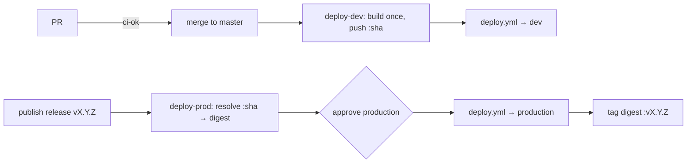

# CI/CD

GitHub Actions workflows live in [`.github/workflows/`](../.github/workflows/). Design and the full target pipeline: ROADMAP §3.11 and [ADR 0006](decisions/0006-trunk-based-release-tags.md). This doc covers what exists today:
- the CI gate, `master` protection and branch cleanup (9a)
- images, environments, deploy workflows, releases and Dependabot (9b)
- Azure login and Bicep provisioning in `deploy.yml`, the `infra` CI job, and the `infra-whatif.yml` PR preview (23a; the infrastructure itself is in [infra.md](infra.md))
- the API rollout in `deploy.yml`: migration job, then the image, then a smoke test (23b)
- the web build and upload to Static Web Apps in `deploy.yml`, and PR preview sites in `web-preview.yml` (23c)



## CI (`ci.yml`)

Runs on every pull request and every push to `master`. Permissions: `contents: read`. A newer push to the same PR cancels the older run; pushes to `master` always run to completion.

| Job | Runs when these change | Steps |
|---|---|---|
| `changes` | always | [`dorny/paths-filter`](https://github.com/dorny/paths-filter) decides which jobs below run |
| `frontend` | `frontend/**`, `shared/**`, `.nvmrc` | Node from `.nvmrc` (24), `npm ci` (npm cache), `tsc --noEmit`, `jest --ci`, `expo lint`, `expo export --platform web` |
| `backend` | `backend/**`, `shared/**` | uv (cache keyed on `backend/uv.lock`), Python 3.12, `uv sync --locked`, `ruff check`, `ruff format --check`, `pytest` against a `postgres:18` service container |
| `docker` | `backend/**`, `shared/data/**`, `.dockerignore` | Builds `backend/Dockerfile` (context = repo root) with buildx and the GHA layer cache; **no push** |
| `infra` | `infra/**` | Installs Bicep (pinned, `v0.49.2`), then [`infra/lint.sh`](../infra/lint.sh): `bicep lint` with SARIF output on every `.bicep` / `.bicepparam`. **Any** diagnostic fails the job, including linter warnings and compiler (BCP) warnings. Rule levels are in `infra/bicepconfig.json`. No Azure login. |
| `ci-ok` | always | Fails if any job above failed or was cancelled; skipped jobs count as passing |

Every filter also matches `.github/workflows/ci.yml`, so a change to CI runs every job. `shared/**` feeds both sides: the engine tests read `shared/data/raw`, and so do the seed and the image.

**Why one aggregate check.** The ruleset requires only `ci-ok`. If each job were required and skipped by a workflow-level `paths:` filter, GitHub would wait forever for a check that never reports. Filtering inside the workflow and aggregating avoids that. When adding a job, add it to `ci-ok`'s `needs`, or it won't gate merges.

**Backend tests in CI.** `backend/tests/conftest.py` prefers `TEST_DATABASE_URL` (set by the job to `…/cubetutor_test` on the service container), creates that database if it's missing, and sets the remaining required settings, so CI uses no `.env`.

**Action pinning.** Third-party actions are pinned to a commit SHA with the release tag in a comment (`@<sha> # v7.0.1`). Tags can be moved; SHAs can't. Bump them by resolving the new tag's SHA (`gh api repos/<owner>/<action>/commits/<tag> --jq .sha`); Dependabot will do this from 9b.

### Reproducing a failure locally

CI runs the same commands as [`/verify`](../.claude/skills/verify/SKILL.md) (which also runs an Android export; it doesn't cover `infra/`). Run `bash .claude/skills/verify/verify.sh`, or the single step from the table in `frontend/` or `backend/`. The backend tests need Compose Postgres up (`docker compose up -d postgres`). The image: `docker build -f backend/Dockerfile .` from the repo root. Bicep: install the [Bicep CLI](https://github.com/Azure/bicep/releases) and `jq`, then `BICEP=<path to bicep> bash infra/lint.sh`.

## `master` protection

A repository ruleset, kept as code in [`.github/rulesets/master.json`](../.github/rulesets/master.json):

- changes reach `master` only through a pull request (0 approvals required; this is a solo repo)
- `ci-ok` must pass; branches don't have to be up to date with `master` before merging
- no force-pushes, no deleting `master`
- **no bypass actors**: this applies to admins too

Applying or updating it (repo admin, once):

```bash
# create
gh api -X POST repos/{owner}/{repo}/rulesets --input .github/rulesets/master.json
# update after editing the file
id=$(gh api repos/{owner}/{repo}/rulesets --jq '.[] | select(.name=="master") | .id')
gh api -X PUT repos/{owner}/{repo}/rulesets/$id --input .github/rulesets/master.json
```

The required check name must match the `ci-ok` job's `name:`. Rename one and you must rename the other, or every PR waits for a check that never comes.

## Branch cleanup

- **Merged PRs:** the repo setting "Automatically delete head branches" deletes the branch. Turn it on with `gh api -X PATCH repos/{owner}/{repo} -F delete_branch_on_merge=true`.
- **PRs closed without merging:** [`cleanup-branch.yml`](../.github/workflows/cleanup-branch.yml) deletes the head branch, but only for branches in this repo (never a fork's) and never `master`. It runs on `pull_request` (not `pull_request_target`) with `contents: write`, and passes the branch name through an env var so it is never interpolated into the shell.
- A deleted branch can be restored from the PR page ("Restore branch").
- Locally, prune the deleted remote branches with `git fetch --prune` (or `git config fetch.prune true`).

## Images (`deploy-dev.yml`)

Every push to `master` builds `backend/Dockerfile` **once** and pushes it to `ghcr.io/aepii/cubetutor-backend:<commit sha>`, then calls `deploy.yml` for `dev` with the pushed **digest** (`…@sha256:…`). There's no path filter, so every commit on `master` has an image and can be released.

- Only the `image` job has `packages: write`. It logs in with the workflow's `GITHUB_TOKEN`, so there are no registry secrets.
- The `org.opencontainers.image.source` label links the package to this repo.
- It doesn't wait for `ci.yml`: the ruleset only lets a PR merge after `ci-ok` passed.
- Deploys queue rather than cancel (`concurrency: deploy-dev`).
- **Package visibility:** a package first pushed by `GITHUB_TOKEN` starts private. After the first push, set it to public once: package page → Package settings → Change visibility. There's no REST endpoint for this. Public lets anyone pull it without credentials, including Container Apps, which has no registry credentials configured.

## Environments

| Environment | Who approves | Deploys allowed from | Used by |
|---|---|---|---|
| `dev` | nobody | branch `master` | `deploy-dev.yml` |
| `production` | the repo owner (required reviewer) | tags `v*` | `deploy-prod.yml` |

Kept as code in [`.github/environments/`](../.github/environments/). **Apply them before any workflow uses them:** GitHub silently creates a missing environment *without* protection.

```bash
gh api -X PUT repos/{owner}/{repo}/environments/dev        --input .github/environments/dev.json
gh api -X PUT repos/{owner}/{repo}/environments/production --input .github/environments/production.json
gh api -X POST repos/{owner}/{repo}/environments/dev/deployment-branch-policies        -f name=master -f type=branch
gh api -X POST repos/{owner}/{repo}/environments/production/deployment-branch-policies -f name='v*'   -f type=tag
```

The ref policies mean a workflow started from a feature branch can't deploy to either environment, even by mistake.

## Deploying (`deploy.yml`)

A reusable workflow with two inputs: `environment` and `image`. It runs in that GitHub environment, so `production` waits for approval before the job starts. It rejects an `image` that isn't `<repo>@sha256:<digest>`, because tags can be moved and digests can't. Then:

1. **checkout** the commit being deployed. For a release that's the tagged commit, so the infrastructure matches the image.
2. **`azure/login` with OIDC** as that environment's deploy identity. Both `deploy.yml`'s job **and the caller job** in `deploy-dev.yml` / `deploy-prod.yml` grant `id-token: write`, because a called workflow can't get more permissions than its caller. No other job has it.
3. **Read the running `api` image** (`az containerapp show`); empty on a fresh environment.
4. **Bicep, pass 1:** `az deployment group create` of `infra/main.bicep` with `infra/<dev|prod>.bicepparam` into `rg-cubetutor-<dev|prod>`. The migration job gets the new digest; `api` gets the image it already runs, so it doesn't change.
5. **Migrate:** [`infra/scripts/run-migration.sh`](../infra/scripts/run-migration.sh) starts the job, polls the execution until `Succeeded`, and gives up after 15 minutes. On `Failed`, `Stopped`, `Degraded` or a timeout, it prints the execution's logs from Log Analytics and fails the step. Ingestion can lag by several minutes, so it waits up to 5 (`LOG_WAIT_SECONDS`). If the logs still aren't there, it says why (the query's error, or that none arrived yet) and prints an `az monitor log-analytics query` command to paste later. The run stops there with `api` untouched.
6. **Bicep, pass 2:** the same deployment with the new digest on `api` too. A new revision takes traffic once its probes pass.
7. **Smoke test:** polls until the latest revision runs the digest, is the latest ready revision, and `GET <api url>/health/ready` returns 200. Back-off 5 → 10 → 20 → 30 s for up to ~3 minutes (cold start from 0 replicas); otherwise the run fails.
8. **Web build:** Node from `.nvmrc`, `npm ci`, then `npx expo export --platform web` in `frontend/`, with `EXPO_PUBLIC_API_URL` set to the API URL from the Bicep output. It fails if `dist/staticwebapp.config.json` is missing.
9. **Web upload:** reads the Static Web App's deployment token with `az staticwebapp secrets list` (the deploy identity's Contributor role; nothing stored in GitHub) and masks it. Then the SWA CLI (`@azure/static-web-apps-cli`, pinned) uploads `frontend/dist` with `--env production`. The CLI, not the deploy action, because the action decides between preview and production from the triggering event (`push`, `release`), and the CLI takes the target explicitly.
10. **Web smoke test:** `GET /` and `GET /learn` on the site must return 200 (6 tries, 10 s apart).
11. **Summary** (always, even after a failure): image digest, migration execution name and result, rollout result, API URL, `/health/ready` status, web URL and web smoke test.

The web steps run after the API is healthy, so a new site never calls an older API. If the web part fails, the API is already rolled out; re-running the run is safe (the Bicep passes and the migration are idempotent).

**Why the web app is built per environment** (the one exception to "nothing rebuilt", [ADR 0006](decisions/0006-trunk-based-release-tags.md)). Expo inlines `EXPO_PUBLIC_*` into the bundle at build time, so the API URL can't be swapped after the build. Each environment's build comes from the same commit and the same `package-lock.json` as the image it ships with, so prod's web build can be reproduced from the release tag. A single build plus a runtime config file (`/config.json` fetched at startup) would remove the exception. That's out of scope until the per-environment build causes a problem.

**Deep links:** [`frontend/public/staticwebapp.config.json`](../frontend/public/staticwebapp.config.json) (Expo copies `public/` into `dist/`) sets `navigationFallback` to `/index.html`, excluding `/_expo/*`, `/assets/*` and static file extensions. A refresh on a client-side route serves the app instead of a 404, and expo-router renders the route from the URL. Tokens are in `localStorage`, so a reload keeps the session.

Why this order and the migration rule it implies: [infra.md § How it's deployed](infra.md#how-its-deployed). The workflow runs with `shell: bash` (pipefail) and lets the Azure CLI install extensions without prompting.

**Testing a failed migration:** a feature branch can't deploy (the `dev` environment only allows `master`), so rehearse it from Cloud Shell with [runbook step 7](../infra/README.md#7-rehearse-a-failed-migration-optional). It runs the same script with a command that fails.

**Azure variables** (IDs, not secrets; set them from the bootstrap outputs, see [`infra/README.md`](../infra/README.md#4-set-the-github-variables)):

| Variable | Level | Used by |
|---|---|---|
| `AZURE_CLIENT_ID` | environment `dev` / `production` (that env's deploy identity) | `deploy.yml` |
| `AZURE_TENANT_ID`, `AZURE_SUBSCRIPTION_ID` | repository | `deploy.yml`, `infra-whatif.yml` |
| `AZURE_WHATIF_CLIENT_ID` | repository (= the dev identity's client ID) | `infra-whatif.yml` |

Tenant and subscription are repository variables because `infra-whatif.yml` has no `environment:` and can't read environment variables.

## Infra preview (`infra-whatif.yml`)

On PRs that touch `infra/**` (or this workflow), it logs in as the **dev** deploy identity and runs `az deployment group what-if` against `rg-cubetutor-dev`, with `apiImage` set to the image dev runs now (so the preview doesn't show a rollback to the placeholder). It posts the result as **one** PR comment and updates it on later pushes: the comment is found by a hidden `<!-- infra-whatif -->` marker, using `gh api` (no third-party action).

- PR jobs can't run in the `dev` environment (it only allows `master`), so the dev identity has an extra federated credential for `repo:aepii/cube-tutor:pull_request`. The trade-off is in [infra.md](infra.md#identities-and-rbac).
- **Prod is never previewed:** the dev identity has no access to it.
- PRs from forks are skipped (they get no OIDC token and no write token).
- It isn't a required check; the `infra` job in `ci.yml` is the gate. A failed what-if still fails this workflow and says so in the comment.
- Permissions: `contents: read`, `id-token: write`, `pull-requests: write`, on that one job.

## Web previews (`web-preview.yml`)

On PRs from this repo that touch `frontend/**`, `shared/**`, `.nvmrc` or the workflow itself, on `opened` / `synchronize` / `reopened` / `closed`:

1. Logs in as the **dev** deploy identity (repository variable `AZURE_WHATIF_CLIENT_ID`, the same `pull_request` federated credential as the what-if).
2. Reads the `swa-cubetutor-dev` deployment token (masked) and the dev API URL (`az containerapp show`, so it's never hardcoded). If `ca-cubetutor-api-dev` doesn't exist (a PR that recreates the dev environment only gets it back from `Deploy dev` after merge), the job warns, still deploys the preview without an API URL, and the comment says login won't work. `closed` reads only the token, so deleting a preview never depends on the API.
3. Builds the web app with `EXPO_PUBLIC_API_URL=<dev API>` and deploys it with [`Azure/static-web-apps-deploy`](https://github.com/Azure/static-web-apps-deploy) (`action: upload`, `skip_app_build`). On a `pull_request` event the action creates the preview environment named after the PR number: `https://<sub>-<PR#>.<region>.<rest>`. The dev API allows that origin through `CORS_ORIGIN_REGEX` ([infra.md](infra.md#secrets)), so login works there.
4. Posts the URL as **one** PR comment and updates it on later pushes (hidden `<!-- web-preview -->` marker, same `gh api` code as the what-if).
5. On `closed` it skips the build and runs the action with `action: close`, which deletes the preview environment, then updates the comment to say so.

- **`pull_request`, never `pull_request_target`:** the PR's code runs with the PR's own token, and PRs from forks are skipped (no OIDC token, read-only token). Permissions: `contents: read`, `id-token: write`, `pull-requests: write`, on that one job.
- **SWA Free allows 3 preview environments;** a deploy beyond that fails. Deleting on close keeps the count down. To list or clean up by hand: `az staticwebapp environment list -n swa-cubetutor-dev -o table`, `az staticwebapp environment delete -n swa-cubetutor-dev --environment-name <PR#>`.
- Previews share the dev database with the dev site, so accounts made on a preview exist on dev too.
- The action is pinned to the head of its `v1` **branch**. The repo also has an old 2021 `v1` tag; the branch is what Microsoft maintains. The action runs a Docker image Microsoft publishes (`mcr.microsoft.com/appsvc/staticappsclient:stable`), which can't be pinned from here.
- Not a required check: `ci-ok` stays the gate.

## Releases (`deploy-prod.yml`)

Trunk-based: there are no release branches, and a release is a tag on a commit that's already on `master` ([ADR 0006](decisions/0006-trunk-based-release-tags.md)).

**Cutting a release:**
1. GitHub → Releases → *Draft a new release*.
2. Create the tag `vX.Y.Z` on `master` (or on an older `master` commit).
3. Click *Generate release notes*. PRs are grouped by label per [`.github/release.yml`](../.github/release.yml).
4. Publish.

**What happens:**
1. **resolve** (read-only) looks up `cubetutor-backend:<tagged commit sha>` and records its digest. If no image exists for that commit (it never went through `deploy-dev`), it fails before any deploy step.
2. **deploy** runs `deploy.yml` for `production` with that digest. The run waits until you approve it (Actions → the run → *Review deployments*).
3. **tag** adds `:vX.Y.Z` to the same digest with `docker buildx imagetools create`, re-reads the tag, and fails if the digest differs. The tag is only added after a successful deploy.

The same image that ran in dev reaches production; nothing is rebuilt. Only `published` releases with a `v*` tag trigger it.

**Rollback:** open the earlier release's `Deploy production` run and click *Re-run all jobs*. A re-run reuses the original event, so it deploys that release's digest again (and needs approval again). Alternatively, publish a new release (e.g. `vX.Y.Z+1`) on the older commit.

## Dependabot

[`.github/dependabot.yml`](../.github/dependabot.yml) opens PRs weekly. Minor and patch updates are grouped into one PR per ecosystem; majors get one PR each. They go through CI and the ruleset like any PR.

| Ecosystem | Directory | Ignored, and why |
|---|---|---|
| npm | `/frontend` | Expo-managed packages (`expo`, `expo-*`, `@expo/*`, `jest-expo`, `react`, `react-dom`, `react-native`, `react-native-*`, `@react-native/*`). Their versions must match the Expo SDK. Upgrade them together with `npx expo install expo@<sdk>` then `npx expo install --fix`. |
| uv | `/backend` | `sqlalchemy>=2.1`, `bcrypt>=5`, `sqlmodel>=0.0.32`: deliberate caps, explained in `backend/pyproject.toml` |
| github-actions | `/` | nothing. Bumps the SHA pins and their `# vX.Y.Z` comments, all in one grouped PR. |
| docker | `/backend` | `python` minor/major (the project requires `<3.13`). The base image is an `ARG` default (`PYTHON_IMAGE`), which Dependabot may not track; check it by hand with each Python patch release. |

Ignored packages still get Dependabot **security** alerts (repo → Security). An ignore only stops version-update PRs.
