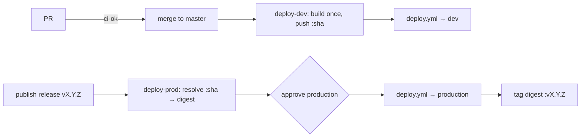

# CI/CD

GitHub Actions workflows live in [`.github/workflows/`](../.github/workflows/). Design and the full target pipeline: ROADMAP §3.11 and [ADR 0006](decisions/0006-trunk-based-release-tags.md). This doc covers what exists today:
- the CI gate, `master` protection and branch cleanup (9a)
- images, environments, deploy workflows, releases and Dependabot (9b)

The deploy workflows have no Azure steps yet (Phase 23).



## CI (`ci.yml`)

Runs on every pull request and every push to `master`. Permissions: `contents: read`. A newer push to the same PR cancels the older run; pushes to `master` always run to completion.

| Job | Runs when these change | Steps |
|---|---|---|
| `changes` | always | [`dorny/paths-filter`](https://github.com/dorny/paths-filter) decides which jobs below run |
| `frontend` | `frontend/**`, `shared/**`, `.nvmrc` | Node from `.nvmrc` (24), `npm ci` (npm cache), `tsc --noEmit`, `jest --ci`, `expo lint`, `expo export --platform web` |
| `backend` | `backend/**`, `shared/**` | uv (cache keyed on `backend/uv.lock`), Python 3.12, `uv sync --locked`, `ruff check`, `pytest` against a `postgres:18` service container |
| `docker` | `backend/**`, `shared/data/**`, `.dockerignore` | Builds `backend/Dockerfile` (context = repo root) with buildx and the GHA layer cache; **no push** |
| `ci-ok` | always | Fails if any job above failed or was cancelled; skipped jobs count as passing |

Every filter also matches `.github/workflows/ci.yml`, so a change to CI runs every job. `shared/**` feeds both sides: the engine tests read `shared/data/raw`, and so do the seed and the image.

**Why one aggregate check.** The ruleset requires only `ci-ok`. If each job were required and skipped by a workflow-level `paths:` filter, GitHub would wait forever for a check that never reports. Filtering inside the workflow and aggregating avoids that. When adding a job, add it to `ci-ok`'s `needs`, or it won't gate merges.

**Backend tests in CI.** `backend/tests/conftest.py` prefers `TEST_DATABASE_URL` (set by the job to `…/cubetutor_test` on the service container), creates that database if it's missing, and sets the remaining required settings, so CI uses no `.env`.

**Action pinning.** Third-party actions are pinned to a commit SHA with the release tag in a comment (`@<sha> # v7.0.1`). Tags can be moved; SHAs can't. Bump them by resolving the new tag's SHA (`gh api repos/<owner>/<action>/commits/<tag> --jq .sha`); Dependabot will do this from 9b.

### Reproducing a failure locally

CI runs the same commands as [`/verify`](../.claude/skills/verify/SKILL.md) (which also runs an Android export). Run `bash .claude/skills/verify/verify.sh`, or the single step from the table in `frontend/` or `backend/`. The backend tests need Compose Postgres up (`docker compose up -d postgres`). The image: `docker build -f backend/Dockerfile .` from the repo root.

## `master` protection

A repository ruleset, kept as code in [`.github/rulesets/master.json`](../.github/rulesets/master.json):

- changes reach `master` only through a pull request (0 approvals required; this is a solo repo)
- `ci-ok` must pass; branches don't have to be up to date with `master` before merging
- no force-pushes, no deleting `master`
- **no bypass actors**: this applies to admins too

Applying or updating it (repo admin, once):

```bash
# create
gh api -X POST repos/{owner}/{repo}/rulesets --input .github/rulesets/master.json
# update after editing the file
id=$(gh api repos/{owner}/{repo}/rulesets --jq '.[] | select(.name=="master") | .id')
gh api -X PUT repos/{owner}/{repo}/rulesets/$id --input .github/rulesets/master.json
```

The required check name must match the `ci-ok` job's `name:`. Rename one and you must rename the other, or every PR waits for a check that never comes.

## Branch cleanup

- **Merged PRs:** the repo setting "Automatically delete head branches" deletes the branch. Turn it on with `gh api -X PATCH repos/{owner}/{repo} -F delete_branch_on_merge=true`.
- **PRs closed without merging:** [`cleanup-branch.yml`](../.github/workflows/cleanup-branch.yml) deletes the head branch, but only for branches in this repo (never a fork's) and never `master`. It runs on `pull_request` (not `pull_request_target`) with `contents: write`, and passes the branch name through an env var so it is never interpolated into the shell.
- A deleted branch can be restored from the PR page ("Restore branch").
- Locally, prune the deleted remote branches with `git fetch --prune` (or `git config fetch.prune true`).

## Images (`deploy-dev.yml`)

Every push to `master` builds `backend/Dockerfile` **once** and pushes it to `ghcr.io/aepii/cubetutor-backend:<commit sha>`, then calls `deploy.yml` for `dev` with the pushed **digest** (`…@sha256:…`). There's no path filter, so every commit on `master` has an image and can be released.

- Only the `image` job has `packages: write`. It logs in with the workflow's `GITHUB_TOKEN`, so there are no registry secrets.
- The `org.opencontainers.image.source` label links the package to this repo.
- It doesn't wait for `ci.yml`: the ruleset only lets a PR merge after `ci-ok` passed.
- Deploys queue rather than cancel (`concurrency: deploy-dev`).
- **Package visibility:** a package first pushed by `GITHUB_TOKEN` starts private. After the first push, set it to public once: package page → Package settings → Change visibility. There's no REST endpoint for this. Public lets anyone, including Azure in Phase 23, pull it without credentials.

## Environments

| Environment | Who approves | Deploys allowed from | Used by |
|---|---|---|---|
| `dev` | nobody | branch `master` | `deploy-dev.yml` |
| `production` | the repo owner (required reviewer) | tags `v*` | `deploy-prod.yml` |

Kept as code in [`.github/environments/`](../.github/environments/). **Apply them before any workflow uses them:** GitHub silently creates a missing environment *without* protection.

```bash
gh api -X PUT repos/{owner}/{repo}/environments/dev        --input .github/environments/dev.json
gh api -X PUT repos/{owner}/{repo}/environments/production --input .github/environments/production.json
gh api -X POST repos/{owner}/{repo}/environments/dev/deployment-branch-policies        -f name=master -f type=branch
gh api -X POST repos/{owner}/{repo}/environments/production/deployment-branch-policies -f name='v*'   -f type=tag
```

The ref policies mean a workflow started from a feature branch can't deploy to either environment, even by mistake.

## Deploying (`deploy.yml`)

A reusable workflow with two inputs: `environment` and `image`. It runs in that GitHub environment, so `production` waits for approval before the job starts. It rejects an `image` that isn't `<repo>@sha256:<digest>`, because tags can be moved and digests can't. For now it only logs the digest and writes a job summary. Phase 23 replaces the placeholder step with Azure OIDC login, the Bicep deploy, the migration job, the Container Apps update and a `/health/ready` smoke test.

## Releases (`deploy-prod.yml`)

Trunk-based: there are no release branches, and a release is a tag on a commit that's already on `master` ([ADR 0006](decisions/0006-trunk-based-release-tags.md)).

**Cutting a release:**
1. GitHub → Releases → *Draft a new release*.
2. Create the tag `vX.Y.Z` on `master` (or on an older `master` commit).
3. Click *Generate release notes*. PRs are grouped by label per [`.github/release.yml`](../.github/release.yml).
4. Publish.

**What happens:**
1. **resolve** (read-only) looks up `cubetutor-backend:<tagged commit sha>` and records its digest. If no image exists for that commit (it never went through `deploy-dev`), it fails before any deploy step.
2. **deploy** runs `deploy.yml` for `production` with that digest. The run waits until you approve it (Actions → the run → *Review deployments*).
3. **tag** adds `:vX.Y.Z` to the same digest with `docker buildx imagetools create`, re-reads the tag, and fails if the digest differs. The tag is only added after a successful deploy.

The same image that ran in dev reaches production; nothing is rebuilt. Only `published` releases with a `v*` tag trigger it.

**Rollback:** open the earlier release's `Deploy production` run and click *Re-run all jobs*. A re-run reuses the original event, so it deploys that release's digest again (and needs approval again). Alternatively, publish a new release (e.g. `vX.Y.Z+1`) on the older commit.

## Dependabot

[`.github/dependabot.yml`](../.github/dependabot.yml) opens PRs weekly. Minor and patch updates are grouped into one PR per ecosystem; majors get one PR each. They go through CI and the ruleset like any PR.

| Ecosystem | Directory | Ignored, and why |
|---|---|---|
| npm | `/frontend` | Expo-managed packages (`expo`, `expo-*`, `@expo/*`, `jest-expo`, `react`, `react-dom`, `react-native`, `react-native-*`, `@react-native/*`). Their versions must match the Expo SDK. Upgrade them together with `npx expo install expo@<sdk>` then `npx expo install --fix`. |
| uv | `/backend` | `sqlalchemy>=2.1`, `bcrypt>=5`, `sqlmodel>=0.0.32`: deliberate caps, explained in `backend/pyproject.toml` |
| github-actions | `/` | nothing. Bumps the SHA pins and their `# vX.Y.Z` comments, all in one grouped PR. |
| docker | `/backend` | `python` minor/major (the project requires `<3.13`). The base image is an `ARG` default (`PYTHON_IMAGE`), which Dependabot may not track; check it by hand with each Python patch release. |

Ignored packages still get Dependabot **security** alerts (repo → Security). An ignore only stops version-update PRs.
